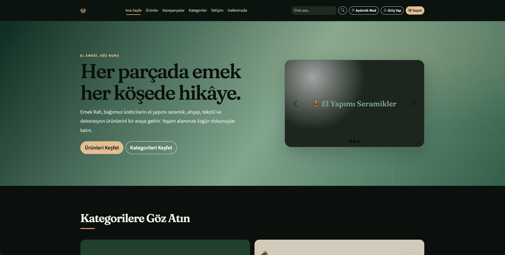
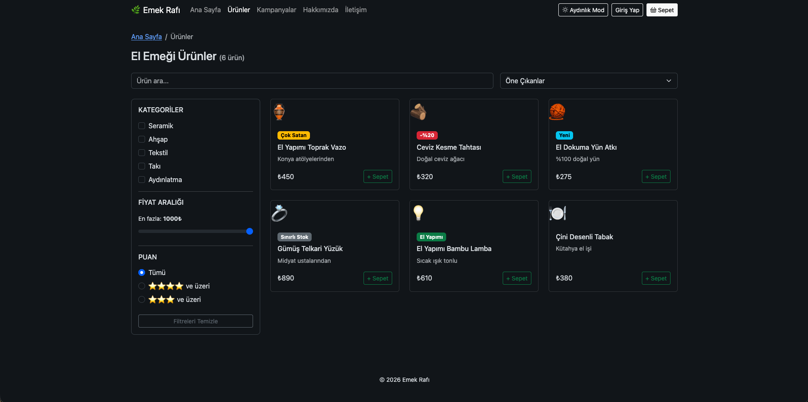
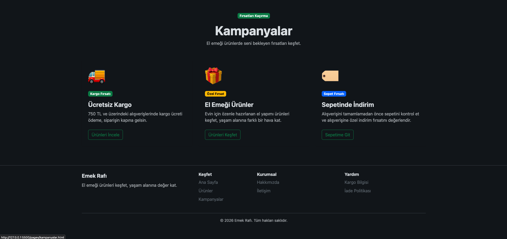
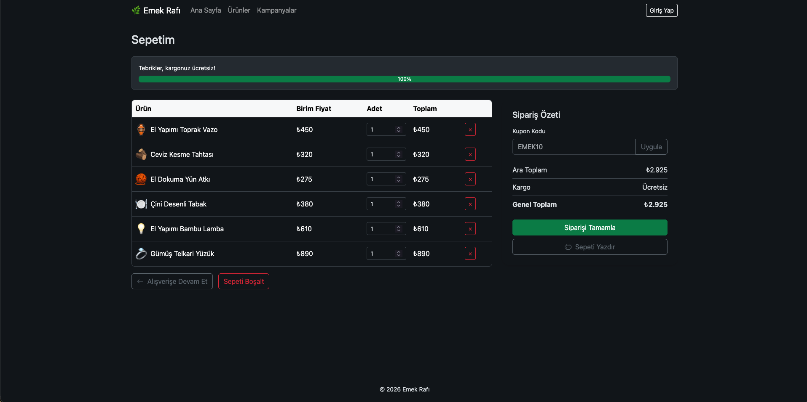
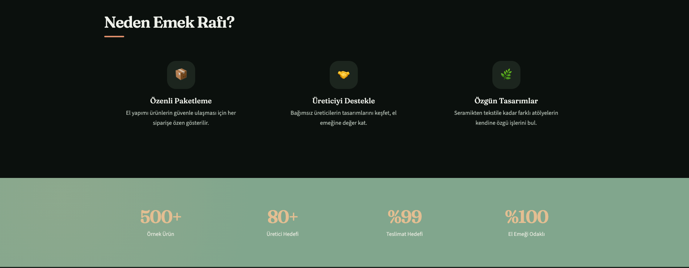

<div align="center">

# 🧶 Emek Rafı

### El Emeğinin Dijital Vitrini

El emeği ürünlerini keşfetmek, incelemek ve kategoriler arasında gezinmek için tasarlanmış bir e-ticaret web arayüzü.

<br>


</div>

---

## 📌 Proje Hakkında

**Emek Rafı**, el emeği ürünlerini dijital ortamda sergilemek amacıyla hazırlanmış örnek bir e-ticaret web projesidir.

Projenin temel amacı, kullanıcıların ürünleri inceleyebildiği, kategoriler arasında gezinebildiği ve farklı sayfalar arasında rahatça geçiş yapabildiği bir web deneyimi sunmaktır.

Arayüz geliştirilirken görsel bütünlük, kullanıcı deneyimi, sayfa düzeni ve farklı ekran boyutlarına uyumluluk gibi konulara odaklanılmıştır.

Proje aynı zamanda HTML, CSS, JavaScript ve Bootstrap kullanılarak hazırlanmış çok sayfalı bir web sitesi örneğidir.

## ✨ Özellikler

- 🏠 **Ana Sayfa:** Ürünlerin ve öne çıkan içeriklerin sergilendiği giriş sayfası.
- 🛍️ **Ürün Listeleme:** Ürünlerin bir arada görüntülenebildiği ürün sayfası.
- 🔎 **Kategori ve Filtreleme:** Ürünlerin kategorilere göre incelenmesine yardımcı olan filtreleme alanları.
- 🧵 **Ürün Detayları:** Ürünlerin daha ayrıntılı incelenebildiği sayfalar.
- 🎯 **Kampanyalar:** Kampanya ve indirim içeriklerinin sergilendiği ayrı sayfa.
- 🛒 **Sepet:** Sepet içeriğinin görüntülenebildiği arayüz.
- 🌙 **Karanlık Mod:** Alternatif bir görünüm için karanlık tema desteği.
- 📱 **Duyarlı Tasarım:** Farklı ekran boyutlarında kullanılabilirliği destekleyen responsive düzenlemeler.
- 📏 **Ürün Ölçüleri:** Ürün detay sayfasında ölçü bilgilerini görüntülemek için modal pencere.
- 📝 **Kayıt Formu:** Doğum tarihi alanı ve 18 yaş kontrolü içeren kayıt arayüzü.
- 📩 **Bildirimler:** Kullanıcıya geri bildirim sunan bildirim bileşenleri.
- 🔗 **Sayfalar Arası Gezinme:** Ana sayfa ve diğer sayfalar arasında bağlantılar.

> Not: Projede bazı özellikler örnek arayüz veya demo davranışı şeklinde çalışmaktadır. Gerçek ödeme sistemi, sunucu taraflı kullanıcı yönetimi ya da canlı sipariş altyapısı bulunduğu varsayılmamalıdır.

---

## 🖥️ Ekran Görüntüleri

### 🏠 Ana Sayfa

Sitenin genel görünümünü, ana sayfa düzenini ve öne çıkan içeriklerini gösterir.



### 🛍️ Ürünler

Ürünlerin listelendiği ve kategori filtreleme alanlarının bulunduğu sayfa.



### 🎯 Kampanyalar

Kampanya içeriklerinin ve öne çıkan fırsatların sergilendiği sayfa.



### 🛒 Sepet

Sepet arayüzünün genel görünümü.



### 🌙 Karanlık Mod

Sitenin karanlık tema etkinleştirildiğindeki görünümü.



---

## 🧰 Kullanılan Teknolojiler

| Teknoloji | Kullanım Amacı |
|---|---|
| HTML5 | Sayfaların yapısını oluşturmak |
| CSS3 | Görsel tasarım, yerleşim ve responsive düzenlemeler |
| JavaScript | Etkileşimler ve dinamik arayüz davranışları |
| Bootstrap | Hazır arayüz bileşenleri ve responsive tasarım desteği |

### HTML5

Web sayfalarının yapısını oluşturmak ve içerikleri anlamlı bölümlere ayırmak için kullanılmıştır.

### CSS3

Renkler, yazı tipleri, boşluklar, bileşen tasarımları, responsive düzenlemeler ve karanlık tema görünümü için kullanılmıştır.

### JavaScript

Kullanıcı etkileşimlerini ve sayfalardaki çeşitli dinamik davranışları desteklemek için kullanılmıştır.

### Bootstrap

Arayüz bileşenleri ve farklı ekran boyutlarına uyumlu yerleşimler oluşturmak için kullanılmıştır.

---

## 📂 Proje Yapısı

```text
Emek-Rafı/
│
├── assets/
│   └── ...
│
├── G.docs/
│   └── ...
│
├── img/
│   ├── AnaSayfa.png
│   ├── Kampanyalar.png
│   ├── Karanlıkmod.png
│   ├── Sepet.png
│   └── Ürünler.png
│
├── Js/
│   └── ...
│
├── pages/
│   └── ...
│
├── Öğrenci.notu/
│   └── ...
│
├── index.html
├── README.md
└── .gitignore
```

> Klasörlerin içindeki dosyalar `...` ile kısaltılmıştır. Projenin gerçek dosya adları ve yapısı esas alınmalıdır.

---

## 🚀 Projeyi Yerel Ortamda Çalıştırma

Projeyi kendi bilgisayarında görüntülemek için aşağıdaki adımları izleyebilirsin.

### 1. Depoyu klonla

Terminali aç ve şu komutu çalıştır:

```bash
git clone https://github.com/RamazanKepelek/emek-rafi.git
```

### 2. Proje klasörüne gir

```bash
cd emek-rafi
```

### 3. Projeyi aç

`index.html` dosyasını tarayıcıda açabilirsin.

Daha rahat bir geliştirme deneyimi için Visual Studio Code kullanabilir ve istersen Live Server gibi bir geliştirme sunucusundan yararlanabilirsin.

> Projenin bazı özellikleri JavaScript dosyalarının doğru yüklenmesine ve sayfaların uygun şekilde açılmasına bağlıdır. Bir özellik doğrudan dosyadan açıldığında çalışmazsa yerel bir geliştirme sunucusu kullanmayı dene.

---

## 📱 Responsive Tasarım

Arayüz hazırlanırken masaüstü ve mobil ekranlarda kullanılabilirliği destekleyen düzenlemeler yapılmıştır.

Responsive tasarım sayesinde sayfa bileşenlerinin farklı ekran genişliklerine uyum sağlaması amaçlanmıştır.

Görünümün tüm cihazlarda aynı olacağı garanti edilmez; farklı ekran boyutlarında ayrıca kontrol edilmesi önerilir.

---

## 🎯 Projenin Amaçları

Emek Rafı projesi kapsamında aşağıdaki konular üzerinde çalışılmıştır:

- Çok sayfalı web sitesi yapısını incelemek.
- HTML ile sayfa iskeletlerini oluşturmak.
- CSS ile arayüz tasarımını düzenlemek.
- Bootstrap bileşenlerinden yararlanmak.
- JavaScript ile etkileşimli arayüz davranışlarını incelemek.
- Responsive tasarım yaklaşımını uygulamak.
- Form doğrulama ve kullanıcı bildirimleri gibi arayüz davranışlarını ele almak.
- Karanlık tema görünümünü değerlendirmek.
- Sayfalar arasındaki bağlantıları ve kullanıcı gezinmesini kontrol etmek.
- Web sitesini Git ve GitHub kullanarak sürüm kontrolü altında yayımlamak.

---

## 🔍 Test ve Kontrol

Proje üzerinde yapılan kontroller kapsamında bazı sayfa ve arayüz davranışları incelenmiştir.

Lighthouse ile ana sayfada yapılan kontrolde **91 puan** elde edilmiştir. Kontrol sırasında dokunma hedeflerinin boyutu veya aralarındaki boşluk ve metin-arka plan kontrastı hakkında uyarılar görülmüştür.

Bu uyarılar tespit edilmiş olmakla birlikte, ilgili iyileştirmelerin tamamlandığı iddia edilmemektedir. Diğer sayfaların kapsamlı biçimde test edilmesi ve ek erişilebilirlik kontrollerinin yapılması ayrıca değerlendirilebilir.

---

## 📚 Öğrenme Süreci

Bu proje, web geliştirme alanındaki kavramları incelemek ve çok sayfalı bir web sitesinin yapısını tanımak amacıyla yürütülmüştür.

Projenin kodlarının büyük bölümü ChatGPT desteğiyle hazırlanmıştır. Çalışma sürecinde sayfalar, stiller ve bazı etkileşimler incelenerek HTML, CSS, JavaScript, Bootstrap ve GitHub gibi konularda bilgi edinilmeye çalışılmıştır.

Proje, bağımsız olarak sıfırdan geliştirilmiş bir çalışma olarak değil, yapay zekâ desteğiyle yürütülen ve süreç içerisinde öğrenme fırsatları sunan bir çalışma olarak değerlendirilmelidir.

---

## 👤 Geliştirici

**Ramazan Kepelek**

GitHub: [@RamazanKepelek](https://github.com/RamazanKepelek)

Proje deposu: [Emek Rafı](https://github.com/RamazanKepelek/emek-rafi)

---

## 📄 Lisans

Bu depo için henüz bir açık kaynak lisansı belirlenmemiştir.

Bir lisans eklenmediği sürece, projenin herkese açık olması başkalarına kodu kullanma, değiştirme veya dağıtma konusunda otomatik olarak izin verildiği anlamına gelmez.

---

<div align="center">

**Emek Rafı — El emeğine dijital bir vitrin.**

</div>